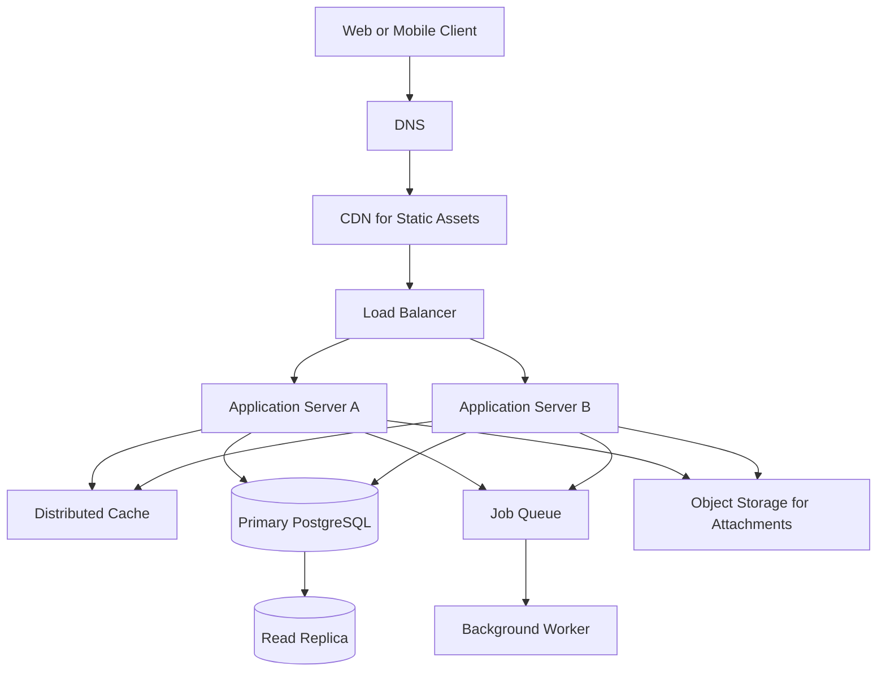

# QuickNotes System Architecture

## Requirements

### Functional requirements

- Users can create, read, update, and delete their own notes.
- Users can organize notes with tags.
- Users can list notes with pagination and retrieve a single note.
- The system validates input and returns consistent API errors.
- Users cannot access another user's notes or tags.

### Non-functional requirements

- Availability target: 99.9% monthly for the API.
- Common note reads should normally complete within 300 ms at the 95th percentile, excluding client network latency.
- Data must be protected with authentication, authorization, encrypted transport, and managed backups.
- The system should scale horizontally for stateless application traffic.
- Logs and metrics should support debugging without exposing note content or credentials.

## Workload estimates

These estimates are planning assumptions, not measured traffic.

- Registered users: 1,000,000.
- Daily active users: 10% of registered users = 100,000.
- Each daily active user performs 20 note reads and 2 writes per day.
- Each note including indexes averages 2 KB of storage.
- Average day: 86,400 seconds.

| Measure | Calculation | Estimate |
|---|---|---:|
| Daily note reads | 100,000 × 20 | 2,000,000/day |
| Average reads per second | 2,000,000 ÷ 86,400 | 23.1/sec |
| Peak reads per second | 23.1 × 5 | 115.7/sec |
| Daily writes | 100,000 × 2 | 200,000/day |
| Average writes per second | 200,000 ÷ 86,400 | 2.3/sec |
| Peak writes per second | 2.3 × 5 | 11.6/sec |
| New stored data per year | 200,000 × 2 KB × 365 | 146 GB/year |

The storage estimate excludes replicas, backups, logs, attachments, and growth in indexes; production capacity should reserve additional space for those items.

## Architecture diagram

## Component responsibilities

- **Web or mobile client:** Collects user input and displays notes and API status.
- **DNS:** Resolves the public application hostname to the service endpoint.
- **CDN:** Caches static HTML, CSS, JavaScript, and other cacheable assets near users to reduce latency and origin traffic.
- **Load balancer:** Distributes API requests across healthy application servers and removes unhealthy instances from rotation.
- **Application servers:** Validate requests, authenticate users, enforce ownership rules, and implement note and tag business logic.
- **Distributed cache:** Stores frequently read note summaries or session data with a short TTL to reduce repeated database work.
- **Primary PostgreSQL database:** Handles authoritative writes and transactional consistency for notes, users, tags, and relationships.
- **Read replica:** Serves suitable read-only queries to reduce pressure on the primary database; replication lag must be considered.
- **Job queue:** Buffers asynchronous work so slow tasks do not block API responses.
- **Background worker:** Processes queued tasks such as export generation, notifications, or cleanup.
- **Object storage:** Stores future attachments outside the relational database and supports durable object retrieval.

## Request flows

### GET `/api/v1/notes`

1. The client resolves the API hostname through DNS and sends an HTTPS request.
2. The load balancer forwards the request to a healthy application server.
3. The application server validates the session and confirms the user's identity.
4. The server checks the cache for a suitable result; on a cache miss, it queries PostgreSQL, using the read replica when the query can tolerate replication lag.
5. The server returns a paginated JSON response and may cache the result briefly.
6. The client renders the returned notes and updates the status message.

### POST `/api/v1/notes`

1. The client sends the note title and body over HTTPS with valid authentication.
2. The load balancer forwards the request to an application server.
3. The server validates the title and body, derives the owner from the authenticated identity, and checks authorization.
4. The server inserts the note into the primary PostgreSQL database in a transaction.
5. The server invalidates or refreshes relevant cached note lists and returns `201 Created` with the new note.
6. Any non-critical follow-up work is placed on the job queue and handled by a worker.

## Trade-offs and reliability

- **Cache speed vs freshness:** Caching reduces database reads but can briefly show stale data. Use short TTLs and invalidate relevant entries after successful writes.
- **Read replica throughput vs consistency:** A replica improves read capacity but may lag behind the primary. Send writes and read-after-write requests to the primary when fresh data is required.
- **Synchronous work vs queueing:** Queues isolate slow tasks from user-facing requests, but introduce eventual consistency and retry requirements. Use idempotent workers and dead-letter handling.
- **Relational structure vs flexible documents:** PostgreSQL enforces relationships and transactions, while schema changes require migrations. The note and tag relationships justify this trade-off for the initial design.

The design avoids single points of failure by running at least two application servers behind a health-checking load balancer, deploying across failure domains where possible, using managed database backups and recovery procedures, and configuring cache and queue services with appropriate redundancy. The primary database remains a critical dependency, so production deployment should include tested failover to a standby or managed high-availability configuration.
